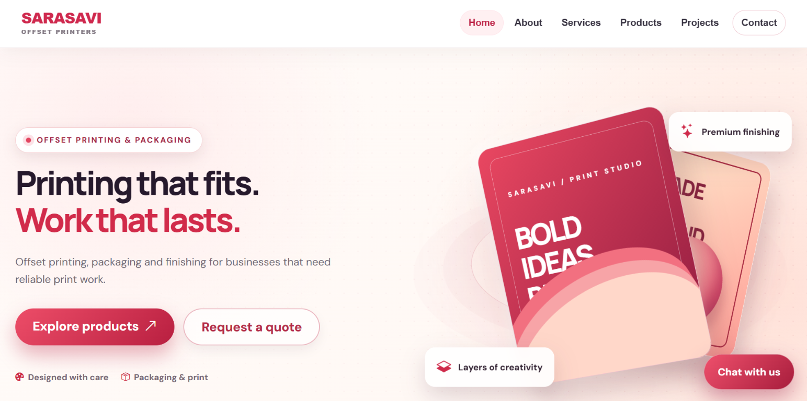

# Sarasavi Printing Solutions

**A modern website for Sarasavi Offset Printers**



## About

Sarasavi Printing Solutions is a website for Sarasavi Offset Printers. It helps customers explore printing services, request quotes, view completed projects, and get support.

## Key features

- Browse printing products and services.
- Request a quote and submit artwork.
- Explore project galleries.
- Get help through customer support.
- Track quote and order requests.
- Manage requests through the local admin tools.

## How it works

**Explore → Request → Manage → Track → Support**

## Technologies

HTML, CSS, JavaScript, Bootstrap, Python, and SQLite.

## Run locally

1. Install Python 3.13 or later.
2. Open a terminal in the `SARASAVI PROJECT` folder.
3. Run:

   ```bash
   python server.py
   ```

4. Open [http://localhost:8000](http://localhost:8000) in your browser.

The server uses Python's standard library. SQLite data and customer artwork are stored in the separate `sarasavi_private_data` folder, outside the website files. Email notifications are optional and require SMTP settings in environment variables.

## Project status and requirements

This project is available for local development and demonstration. It requires Python 3.13 or later and a modern web browser; no additional Python packages are needed. The local server is not intended for public production hosting without further deployment and security work.
